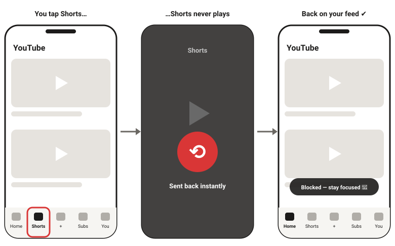
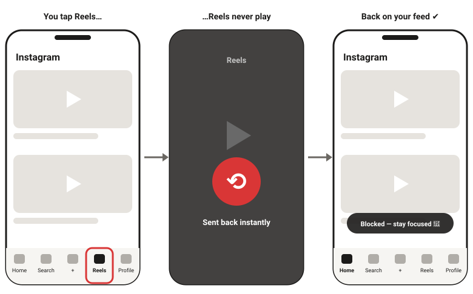

# Shorts Blocker for Android

**Keep YouTube and Instagram. Lose the Shorts and Reels.**

Shorts Blocker stops **YouTube Shorts** and **Instagram Reels** on your Android phone. The moment one opens, it sends you straight back. Everything else keeps working: normal YouTube videos, search, subscriptions, Instagram posts, Stories and messages.

- ✅ Free, no account, no ads
- 🔒 No internet access: nothing ever leaves your phone
- 👀 Looks at YouTube and Instagram only, never your other apps
- 🎚️ Choose what to block: YouTube Shorts, Instagram Reels, or both
- 🔋 Uses almost no battery
- ⏳ 30-second wait before you can pause or turn it off, so you don't give in on impulse

---

## How it works

**YouTube:** Shorts never play. You land back where you were.

**Instagram:** Reels never play. Your feed, Stories and DMs still work.

---

## ⬇️ Download

**[Download ShortsBlocker.apk](https://github.com/NaveedShariff/ShortsBlocker/releases/latest/download/ShortsBlocker.apk)** (version 2.0)

Open this link **on your Android phone** (Android 8 or newer). Setup takes about 3 minutes and you only do it once.

---

## 🛡️ Is it safe? Why does my phone show a warning?

**Yes, it's safe.** Your phone may show **"App blocked to protect your device"** or **"Harmful app"**. That warning is about *how* the app is installed, not what it does:

- Android shows it for **every** app that comes from outside the Play Store **and** uses the *Accessibility* permission. Shorts Blocker needs Accessibility to notice when a Short or Reel opens and press Back for you, which is the same way other blocker apps work.
- Shorts Blocker has **no internet permission**. Android itself prevents it from sending anything off your phone, so it can't upload your data even in theory.
- It looks **only** at YouTube and Instagram. It can't see your messages, passwords, banking apps or anything else.
- It stores just 4 things on your phone: on/off, your pause timer, which apps to block, and today's block count.
- All the code is public in this repository, so anyone can check it.

So you'll need to let Android install it once, using the steps below. When Shorts Blocker is on the Play Store, this warning will go away.

---

## Step 1: Install the app

### 1a. Switch off Play Protect for a moment

Play Protect blocks the install because of the rule explained above. Switch it off, install, then switch it back on:

1. Open the **Play Store** app.
2. Tap your **profile photo** (top right) → **Play Protect**.
3. Tap the **⚙ gear** (top right).
4. Switch **OFF** "Scan apps with Play Protect" and confirm.

> ⚠️ **Remember to switch it back ON after Step 1b.** Shorts Blocker stays installed.

### 1b. Install

1. Open the downloaded **ShortsBlocker.apk** (from your notifications or the **Files → Downloads** folder).
2. If it says *"Install unknown apps"*, tap **Settings**, switch **Allow from this source** ON, and go back.
3. Tap **Install**.
4. Now **switch Play Protect back ON** (same steps as 1a).

---

## Step 2: Turn on the blocker

1. Open **Shorts Blocker** and tap **Turn on Shorts Blocker**.
2. Read the note and tap **I agree**. Your phone's **Accessibility** settings open.
3. Find **Shorts Blocker**. It may be under *Downloaded apps*, *Installed apps* or *Installed services*.
4. Switch it **ON**, then tap **Allow**.
5. Go back to Shorts Blocker. It should now say **🛡 Protecting you**.

### Is the switch greyed out, or does it say "Restricted setting"?

Android 13 and newer does this for apps installed outside the Play Store. Fix:

1. Go to **Settings → Apps → Shorts Blocker**. Or tap **Open app info** inside Shorts Blocker.
2. Tap **⋮** in the top-right corner → **Allow restricted settings** (confirm with your PIN or fingerprint).
3. Go back to Step 2 and switch it ON again.

---

## Step 3: Stop your phone from switching it off

Many phones close background apps to save battery, which can stop the blocker. Shorts Blocker uses almost no battery, so it's safe to let it run.

**All phones:** go to **Settings → Apps → Shorts Blocker → Battery** and choose **Unrestricted**. Or tap **Keep it running (battery settings)** in the app.

Then follow the steps for your brand. Menu names can differ slightly between models.

<b>Vivo / iQOO</b>

1. **Settings → Battery → Background power consumption management** → Shorts Blocker → **Don't restrict background power usage**.
2. **Settings → Apps → Permissions → Autostart** (or **i Manager → App manager → Autostart**) → switch Shorts Blocker **ON**.
3. Open recent apps, **pull the Shorts Blocker card down** (or long-press it → 🔒) to lock it.

<b>Xiaomi / Redmi / POCO</b>

1. **Settings → Apps → Manage apps → Shorts Blocker → Battery saver → No restrictions**.
2. In the same screen, switch **Autostart** ON.
3. Open recent apps, long-press the Shorts Blocker card → 🔒 lock.

<b>Samsung</b>

1. **Settings → Apps → Shorts Blocker → Battery → Unrestricted**.
2. **Settings → Battery → Background usage limits** → make sure Shorts Blocker is **not** in *Sleeping apps* or *Deep sleeping apps*.

<b>Oppo / Realme / OnePlus</b>

1. **Settings → Apps → Shorts Blocker → Battery usage** → switch ON **Allow background activity** (and **Allow auto launch** if shown).
2. Open recent apps, tap ⋮ on the Shorts Blocker card → **Lock**.

---

## Step 4: Test it ✅

**YouTube** (tap **Test it: open YouTube** in the app):

| Try this | What should happen |
|---|---|
| Tap the **Shorts** tab | You're sent back |
| Tap a Short in the **home feed** | You're sent back |
| Tap a Short in **search results** | You're sent back |
| Open a **Shorts link** someone sent you | You're sent back or to your home screen |
| Play a **normal video** | Plays normally ✔ |

**Instagram:**

| Try this | What should happen |
|---|---|
| Tap the **Reels** tab (bottom bar) | You're sent back |
| Open a Reel from **Explore / Search** | You're sent back |
| Open a **Reel someone sent you** in DMs | You're sent back |
| Scroll your **home feed**, watch **Stories**, send **messages** | Works normally ✔ |

Want to block only one app? In Shorts Blocker, switch **Block YouTube Shorts** or **Block Instagram Reels** off.

---

## Questions

**Does it run all the time?**
Yes. Once it's on, it works 24/7, even after you restart your phone or clear recent apps. You never need to open the app again.

**How much battery does it use?**
Almost none. It only wakes up while YouTube or Instagram is open, and it uses no internet or GPS.

**What can it see?**
Only the *layout* of the YouTube and Instagram screens (not the videos, not your messages, not other apps), just enough to notice the Shorts or Reels player. It stores only on/off, a pause timer, which apps to block and today's block count. It has no internet permission, so it couldn't send anything even if it wanted to.

**How do I take a break?**
In the app, tap **Pause or turn off**, wait 30 seconds, then choose **15 min**, **1 hour** or **Turn off**. A pause ends by itself.

**Shorts or Reels got through. What now?**
Open Shorts Blocker and check it says **🛡 Protecting you**. If it says "Not set up yet", your phone switched it off: do Step 2 again and check Step 3. Also check the **Block YouTube Shorts** / **Block Instagram Reels** switches. If everything is on and they still get through, YouTube or Instagram may have changed its app. Please [open an issue](https://github.com/NaveedShariff/ShortsBlocker/issues) with your phone model.

**How do I update?**
Download the APK again from the link above and install it over the old one. Your settings stay, and you don't need to set it up again.

**How do I uninstall?**
Settings → Apps → Shorts Blocker → Uninstall.

---

For developers

- Plain Java + Android framework, no external libraries. Min SDK 26, target SDK 35.
- Every push to `main` builds the APK with GitHub Actions and publishes it as a new Release.
- Detection rules (YouTube Shorts and Instagram Reels view IDs) live in `app/src/main/res/values/detection.xml`. If an app changes its layout, find the new IDs with `adb shell uiautomator dump` while a Short or Reel is open, update that file and push.

