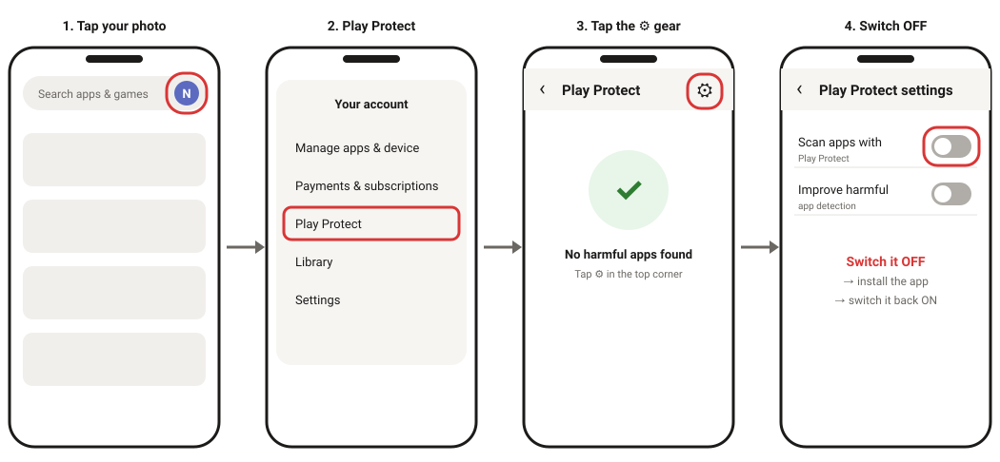
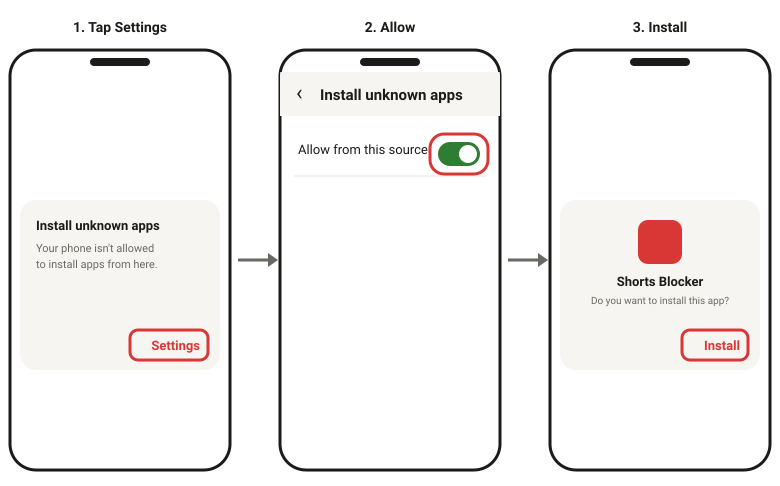
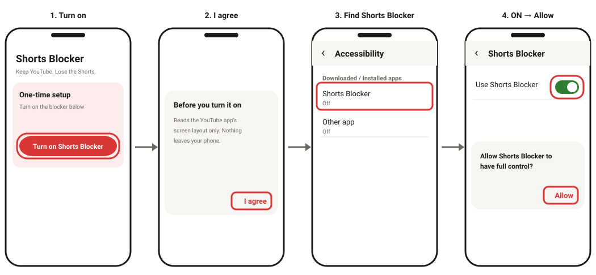
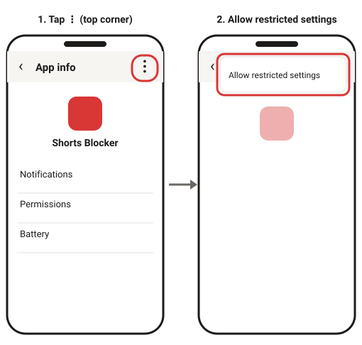
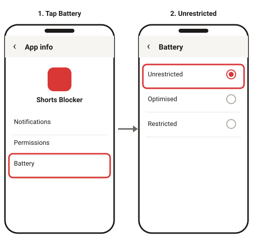

# Shorts Blocker for Android

**Keep YouTube. Lose the Shorts.**

Shorts Blocker stops YouTube Shorts on your Android phone. The moment a Short opens in the YouTube app, it sends you straight back. Normal videos, search and subscriptions keep working.

- ✅ Free, no account, no ads
- 🔒 No internet access: nothing ever leaves your phone
- 👀 Looks at the YouTube app only, never your other apps
- 🔋 Uses almost no battery
- ⏳ 30-second wait before you can pause or turn it off, so you don't give in on impulse

---

## ⬇️ Download

**[Download ShortsBlocker.apk](https://github.com/NaveedShariff/ShortsBlocker/releases/latest/download/ShortsBlocker.apk)**

Open this link **on your Android phone** (Android 8 or newer). Setup takes about 3 minutes and you only do it once.

---

## Step 1: Install the app

### 1a. Switch off Play Protect for a moment

Google Play Protect blocks apps from outside the Play Store that ask for the Accessibility permission. Shorts Blocker needs that permission to see when a Short opens, so Play Protect may show **"App blocked to protect your device"**. The app is safe; this is a general rule, not a problem with Shorts Blocker.

To get past it, switch Play Protect off, install, then switch it back on:

1. Open the **Play Store** app.
2. Tap your **profile photo** (top right) → **Play Protect**.
3. Tap the **⚙ gear** (top right).
4. Switch **OFF** "Scan apps with Play Protect" and confirm.

> ⚠️ **Remember to switch it back ON after Step 1b.** Shorts Blocker stays installed.

### 1b. Install

1. Open the downloaded **ShortsBlocker.apk** (from your notifications or the **Files → Downloads** folder).
2. If it says *"Install unknown apps"*, tap **Settings**, switch **Allow from this source** ON, and go back.
3. Tap **Install**.
4. Now **switch Play Protect back ON** (same steps as 1a).

---

## Step 2: Turn on the blocker

1. Open **Shorts Blocker** and tap **Turn on Shorts Blocker**.
2. Read the note and tap **I agree**. Your phone's **Accessibility** settings open.
3. Find **Shorts Blocker**. It may be under *Downloaded apps*, *Installed apps* or *Installed services*.
4. Switch it **ON**, then tap **Allow**.
5. Go back to Shorts Blocker. It should now say **🛡 Protecting you**.

### Is the switch greyed out, or does it say "Restricted setting"?

Android 13 and newer does this for apps installed outside the Play Store. Fix:

1. Go to **Settings → Apps → Shorts Blocker**. Or tap **Open app info** inside Shorts Blocker.
2. Tap **⋮** in the top-right corner → **Allow restricted settings** (confirm with your PIN or fingerprint).
3. Go back to Step 2 and switch it ON again.

---

## Step 3: Stop your phone from switching it off

Many phones close background apps to save battery, which can stop the blocker. Shorts Blocker uses almost no battery, so it's safe to let it run.

**All phones:** go to **Settings → Apps → Shorts Blocker → Battery** and choose **Unrestricted**. Or tap **Keep it running (battery settings)** in the app.

Then follow the steps for your brand. Menu names can differ slightly between models.

<b>Vivo / iQOO</b>

1. **Settings → Battery → Background power consumption management** → Shorts Blocker → **Don't restrict background power usage**.
2. **Settings → Apps → Permissions → Autostart** (or **i Manager → App manager → Autostart**) → switch Shorts Blocker **ON**.
3. Open recent apps, **pull the Shorts Blocker card down** (or long-press it → 🔒) to lock it.

<b>Xiaomi / Redmi / POCO</b>

1. **Settings → Apps → Manage apps → Shorts Blocker → Battery saver → No restrictions**.
2. In the same screen, switch **Autostart** ON.
3. Open recent apps, long-press the Shorts Blocker card → 🔒 lock.

<b>Samsung</b>

1. **Settings → Apps → Shorts Blocker → Battery → Unrestricted**.
2. **Settings → Battery → Background usage limits** → make sure Shorts Blocker is **not** in *Sleeping apps* or *Deep sleeping apps*.

<b>Oppo / Realme / OnePlus</b>

1. **Settings → Apps → Shorts Blocker → Battery usage** → switch ON **Allow background activity** (and **Allow auto launch** if shown).
2. Open recent apps, tap ⋮ on the Shorts Blocker card → **Lock**.

---

## Step 4: Test it ✅

Tap **Test it: open YouTube** in the app, then try:

| Try this | What should happen |
|---|---|
| Tap the **Shorts** tab | You're sent back |
| Tap a Short in the **home feed** | You're sent back |
| Tap a Short in **search results** | You're sent back |
| Open a **Shorts link** someone sent you | You're sent back or to your home screen |
| Play a **normal video** | Plays normally ✔ |

---

## Questions

**Does it run all the time?**
Yes. Once it's on, it works 24/7, even after you restart your phone or clear recent apps. You never need to open the app again.

**How much battery does it use?**
Almost none. It only wakes up while YouTube is open, and it uses no internet or GPS.

**What can it see?**
Only the *layout* of the YouTube app's screen (not the video, not other apps), just enough to notice the Shorts player. It stores only on/off, a pause timer and today's block count. It has no internet permission, so it couldn't send anything even if it wanted to.

**How do I take a break?**
In the app, tap **Pause or turn off**, wait 30 seconds, then choose **15 min**, **1 hour** or **Turn off**. A pause ends by itself.

**Shorts got through. What now?**
Open Shorts Blocker and check it says **🛡 Protecting you**. If it says "Not set up yet", your phone switched it off: do Step 2 again and check Step 3. If it is on and Shorts still get through, YouTube may have changed its app. Please [open an issue](https://github.com/NaveedShariff/ShortsBlocker/issues) with your phone model.

**How do I update?**
Download the APK again from the link above and install it over the old one. Your settings stay.

**How do I uninstall?**
Settings → Apps → Shorts Blocker → Uninstall.

---

For developers

- Plain Java + Android framework, no external libraries. Min SDK 26, target SDK 35.
- Every push to `main` builds the APK with GitHub Actions and publishes it as a new Release.
- Detection rules (YouTube's Shorts view IDs) live in `app/src/main/res/values/detection.xml`. If YouTube changes its layout, find the new IDs with `adb shell uiautomator dump` while a Short is open, update that file and push.

